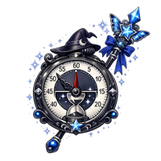
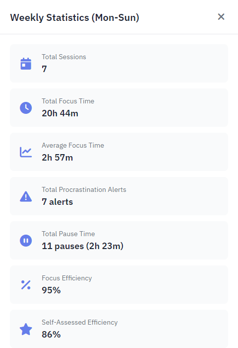

<p align="center"></p>

<h1 align="center">Focus Pocus</h1>

<p align="center">A small focus timer that floats above your other windows and calls you back when you drift off.</p>

---

## What it does

- ⏱️ **Notices when you stop.** No keyboard or mouse input for 10 minutes (you can change this) sets off an alert.
- 📺 **Knows your rabbit holes.** Add sites or apps like `youtube` or `netflix` to your blocklist. Spend 15 seconds on one and you get a nudge.
- 🔊 **Gets louder if you ignore it.** The alert beeps every 5 seconds until you press **Got it**, louder each time.
- 🔇 **Warns you when you're muted.** If your computer is muted or very quiet, a banner tells you, with a one-click fix. You can also let it unmute for alerts.
- ⏸️ **Counts breaks honestly.** Pause and resume as often as you like. Breaks are timed separately. If you want, turn on a break reminder in ⚙️ Settings and it will ask, each time you pause, whether to nudge you back after a number of minutes. It's off by default.
- 🔥 **Asks how it went.** When you stop, rate the session from 😢 to 🔥.
- 📊 **Shows you the trend.** Daily, weekly and monthly stats, with your rating next to the measured efficiency.

## How your data is kept

Your sessions, your blocklist and the folder you want the logs at are **never** uploaded anywhere.

**Pick where your data goes** in ⚙️ Settings under **Where your data is kept**. By default it's `Documents/FocusPocus/`, which holds a `logs/` folder (one file per day of sessions) and `blacklist.json` (your blocklist).

If you choose a folder **inside this repo**, add its name to `.gitignore` before you commit anything, so your personal logs never get pushed to GitHub. The repo already ignores `logs/` and `logs-dev/`, and the only sessions it ships are the **made-up** ones in `logs-sample/`.

## Stats

Click **Daily**, **Weekly** or **Monthly** in the main window. Here's the weekly view, filled with the sample data:



**Measured efficiency** counts each alert as 10 lost minutes: focus time ÷ (focus time + alerts × 10 min).

If you want to see what the stats look like before you have sessions of your own, run `npm run dev`, since dev mode uses a separate `logs-dev/` folder of fake sessions and never touches your real data.

## Run it

You'll need [Node.js](https://nodejs.org/) (the LTS version).

```bash
git clone https://github.com/mnicolee/Focus-Pocus.git
cd Focus-Pocus
npm install
npm start
```

On Windows you can also double-click **`Start Focus Pocus.bat`**.

Once it's open, go to ⚙️ Settings and **add your distractions to the blocklist** (like `youtube`, `tiktok` or `netflix`), because Focus Pocus can only nudge you about the sites and apps it knows about.

To build a standalone `.exe` in `dist/`, run `npm run build`.

## Troubleshooting

- **No sound on alerts?** Check the orange banner in the main window. Your computer may be muted. Turn on ⚙️ Settings → **Turn my sound on for alerts** to let Focus Pocus unmute for you. The taskbar button also flashes on every alert.
- **Blocklist not catching a site?** Focus Pocus matches the words in the window title. Use the name as it appears in the browser tab (e.g. `youtube`, not `youtu.be`).
- **Stats show N/A for your rating?** You haven't rated a session in that period yet.

## Licence

Apache 2.0. See [LICENSE](LICENSE).
